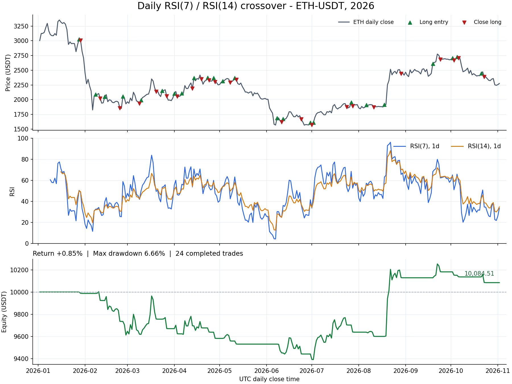

# 日线 RSI7 / RSI14 金叉死叉策略

已创建策略 `rsi7-rsi14-daily-cross`，并保存到 `strategies/rsi7-rsi14-daily-cross.json` 与当前 `data/app.db` 策略库，revision 为 1。策略库由 1 条增加到 2 条。本次没有启动常驻服务。

## 交易规则

- 使用已收盘 UTC 日线的 Wilder RSI(7) 和 RSI(14)。
- 金叉：前一日 RSI7 ≤ RSI14，当前日 RSI7 > RSI14，空仓时开多。
- 死叉：前一日 RSI7 ≥ RSI14，当前日 RSI7 < RSI14，有多仓时全部平仓。
- 仅做多，不加仓；没有额外 RSI 阈值、止盈或止损条件。
- 在日线收盘时产生信号，在下一根基础 K 线开盘撮合。底层数据粒度为 15 分钟，指标粒度为 1 天；策略文件的 `data.timeframe: "15m"` 是撮合输入，两个指标的 `timeframe` 均为 `"1d"`。
- 首仓基础名义金额为权益的 20%，配置杠杆 1 倍；盈利后沿用项目默认的首仓资金衰减，实际金额不超过上述比例。

RSI14 需要 15 根完整日线完成初始化。初始化不足时没有信号，盘中不会更新日线 RSI。

## 本次回测

| 参数 | 设置 |
|---|---|
| 标的 / 市场 | ETH-USDT 永续，单标的 NET |
| 数据集 | `binance-perpetual-15m-20191231160000-20261102140000` |
| 区间 UTC | `[2026-01-01 00:00, 2026-11-02 00:00)` |
| 数据量 | 29,280 根 15m K 线，305 根完整日线 |
| 初始资金 | 10,000 USDT |
| 首仓基础比例 / 杠杆 | 20% / 1x |
| 首仓资金衰减系数 | 多头 0.5 |
| 吃单费率 / 滑点 | 0.04% / 2 bps |
| 维持保证金率 | 0.5% |
| 回撤停机 | 关闭 |

| 结果 | 数值 |
|---|---:|
| 最终权益 | 10,084.5140 USDT |
| 净收益 | +84.5140 USDT |
| 总收益率 | +0.8451% |
| 最大回撤 | 6.6556% |
| 成交笔数 | 48 |
| 完整持仓轮次 | 24 |
| 盈利 / 亏损轮次 | 5 / 19 |
| 净盈利胜率 | 20.8333% |
| 利润因子（按轮次净盈亏） | 1.0831 |
| 总手续费 | 37.4106 USDT |
| 平均持仓时间 | 5.1667 天 |
| 期末持仓 | 空仓 |
| 爆仓次数 | 0 |

这组配置在样本窗口内接近盈亏平衡，盈利集中于少数持仓轮次。回测计入普通交易手续费和滑点，未计入永续资金费，也未进行参数搜索或样本外验证。



图表按日线收盘时点抽样；成交标记使用实际成交时间和成交价。最大回撤使用完整 15m 账户快照计算。

## 验证记录

- 策略文件与 SQLite revision 均通过项目现有严格解码、语义校验与编译器校验。
- 用独立 Python Wilder RSI 计算核验 589 个有效日线输出，最大绝对误差为 `3.552713678800501e-14`。
- 核验 57,948 次盘中指标保持不变的比较，日线 RSI 只在日线完成后更新。
- 独立得到 24 个金叉、25 个死叉；首个死叉发生时为空仓，因此实际有 24 次开多、24 次平多，48 个订单与规则一致。
- 48 笔成交均验证为信号之后的下一根基础 K 线开盘成交。
- 成交账本重放与最终账户一致；24 轮净盈亏之和与最终权益变化一致。

归档 run ID：`run-b9ea7374b71a616f89610b2b9d9d0820`。策略定义 SHA-256：`d530a25d304ac512bcc5cf23bc5782f9cbe937647180c3b62310bb5f0ecef415`。

完整运行输入与结果已保存到当前 SQLite 回测历史。[策略 JSON](strategies/rsi7-rsi14-daily-cross.json)、[日线序列与交易验证数据](daily-rsi-cross-backtest.json)、[图表](daily-rsi-cross-backtest.png)。

## 在项目中查看

启动服务后，在策略管理或行情回测的策略选择器中选择“日线 RSI7 / RSI14 金叉死叉（只做多）”。运行历史中可查看本次归档。

重新发起回测时，选择上述 ETH 数据集并将区间设为 2026-01-01 至 2026-11-02；默认 7 天演示行情不足以初始化 RSI14 日线。

CLI 可直接复跑：

```bash
go run ./cmd/backtest -db data/app.db \
  -strategy-id rsi7-rsi14-daily-cross -strategy-revision 1 \
  -run -data-root data/market -report summary
```
