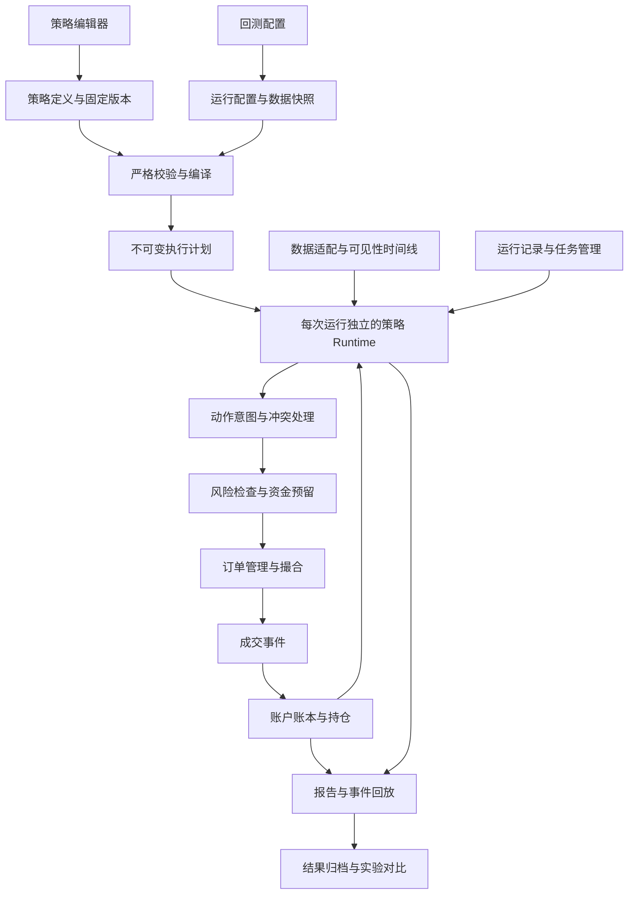

# 策略管理解耦与完整回测链路方案

分析日期：2026-11-05  
代码基线：`96911ac`，`feat: 新增可视化加仓间距功能`  
状态：本轮核心回测链路解耦已完成，包括第一阶段、编译计划与运行实例隔离、数据快照、统一撮合账本、独立风险配置、持久化任务和前端运行入口。新增策略原语、HEDGE、多标的与实验优化仍按下述阶段扩展。验收见 [核心链路完成记录](strategy-architecture-completion-report.md)；早期正确性修复见 [第一阶段记录](strategy-architecture-phase1-report.md)。

后续已实现固定维持保证金率的线性全仓强平判定、成交 / 账本与结果展示，最低账户 MMR 采用 `min(E/M)`，见 [MMR 验证记录](mmr-liquidation-report.md)。交易所分档维持保证金率、资金费、逐仓与完整保证金模型仍为后续能力。

## 1. 范围与现有基础

目标是建立可组合、可扩展、可复现的回测系统，优先覆盖基于 K 线的趋势、突破、均值回归、分层加仓、定投、网格和组合策略。完整链路包括策略编写、校验、版本管理、数据准备、执行、账户核算、结果保存、原因追溯和实验对比。“大部分策略”的范围通过代表策略验收确定，不使用未经测量的覆盖率承诺。

当前已经具备严格 JSON 解码、语义校验、指标依赖排序、表达式 AST、真实行情读取、下一根开盘成交、分层加仓、结构化退出和 SQLite 策略 revision。上述能力构成继续演进的基础。[E1](#e1)[E2](#e2)[E3](#e3)

现有数据下载、清洗与存储代码实际位于 Go 的 `internal/datafeed` 和 `internal/dataset`。早期约定的 Python 数据生产方向可以通过统一数据契约接入；本方案优先建立边界，不要求先迁移已经工作的数据实现。[E4](#e4)

初始方案结论来自源码和接口检查。本轮实施已通过固定真实行情前后回归、账本重放、并发隔离及浏览器验收；未执行性能基准，也未证明尚未实现策略的运行正确性。性能收益和更广泛的策略覆盖率需要后续测量。

## 2. 当前耦合点与能力限制

| 位置 | 已确认事实 | 对扩展的影响 | 建议 |
|---|---|---|---|
| 前端策略控制器 | `web/src/strategy.js` 共 2,554 行，包含 API、草稿修改、迁移、条件转换、字段渲染和事件绑定 | 新增策略能力时需要同时修改多段 UI 和业务逻辑 | 分离草稿状态、合约适配、编辑组件和能力目录 |
| 策略定义 | `Definition` 同时包含数据集、日期、初始账户、手续费、策略规则和报告之外的执行设置 | 修改测试环境也会改变策略配置；逻辑复用与实验比较边界不清晰 | 拆分策略逻辑与回测运行配置 |
| 校验与账户 | 校验要求一个标的、`max_open_positions = 1`；账户只有一个有符号持仓数量 | 不能承载多标的组合或同标的双向持仓 | 建立组合账户与显式持仓模式 |
| 规则调度 | 当前执行循环选择第一条匹配且可执行的规则后 `break` | 不能直接表达一轮生成多个挂单、组合调仓或篮子动作 | 显式定义规则冲突与动作批次策略 |
| 数值表达式 | 数值节点目前只有常量和引用；运算符以逻辑、比较、交叉和趋势变化为主 | 一般算术价格公式需要新增专用结构 | 扩展经过类型检查的数值表达式 |
| 编译计划 | `IndicatorPlan` 持有会被 `Reset/Update` 的指标实例，`RulePlan.When` 仍是原 AST | 共享或缓存整个计划会共享可变状态；规则引用仍在运行时按名字查找 | 分离不可变计划和每次运行的 runtime |
| 撮合与账户 | `fillOrder` 直接调用账户开平仓；触发价退出另有直接平仓路径 | 新订单类型、成交事件与账本容易分散在多个路径 | 建立统一 Broker → Fill → Ledger 路径 |
| 回测运行 | API 请求中同步读取行情并执行，仓库只保存策略与策略 revision | 缺少独立的运行记录、进度、取消、结果归档与实验比较 | 增加 BacktestRun 生命周期 |
| 报告与内存 | 运行中保留完整指标历史和资金曲线，最后按 ReportSpec 裁剪输出 | 长时间、多标的、批量实验容易增加内存压力 | 编译时计算历史需求，报告按需订阅和落盘 |
| 交易环境 | Manifest 有市场规则元数据，但现有撮合接口不消费这些规则；输入主要是 OHLCV | 手数、价格精度、最小名义金额、资金费和强平模型不完整 | 增加交易环境适配器和事件型账本 |

前端、合约、编译器、账户、执行循环和服务接口分别支持以上判断。[E1](#e1)[E2](#e2)[E3](#e3)[E5](#e5)[E6](#e6)[E7](#e7)

### 2.1 应先处理的正确性问题

**渲染与迁移混合（基线缺陷，已修正）。** 基线的 `renderVisualDetail` 调用 `migrateRuleSizing`，`renderOverviewForm` 调用 `migrateLeverageConfig`，保存前再次原地迁移。现在由独立、无副作用的 `StrategyContractAdapter` 在加载、JSON 转可视化及保存边界执行迁移；保留 API 返回的版本配置，编辑器修改单独的草稿。退出策略的展示默认值也不再写回配置。[E1](#e1)

**持仓历史引用语义不完整（基线缺陷，已修正）。** 基线校验允许 `position` 引用使用负 `offset`，但运行时混用当前仓位与历史价格。现在负偏移读取对应 K 线收盘后的持仓快照，并用该根收盘价计算浮动盈亏与实际杠杆。快照包含开盘成交、盘中退出和持仓极值更新后的状态；本根收盘信号只创建订单。历史不足或已经不可用时返回缺值，比较条件不命中；不回退到当前仓位。`offset=0` 仍读取当前收盘持仓。[E5](#e5)[E6](#e6)

**默认值和风险限额混合（运行边界已修正）。** V1 `Normalize` 的历史别名语义仅在 `AdaptV1` 边界保留；独立 `RunConfig` 通过 `ValidateRunConfig` 验证，不再归一化覆盖显式风险预算。单标的和总敞口额度由风险层约束新仓准入，交易所杠杆上限继续有效。[E2](#e2)

**前端运行 revision（已固定）。** 运行控制器读取版本快照并显示 revision / 定义哈希，提交时明确指定该 revision。选择期间的新版本不改变当前实验；用户可显式加载最新版本。CLI 同样固定预检时解析出的 revision。[E3](#e3)[E8](#e8)

**数据文件执行约束（已实现）。** `ReadSnapshot` 对实际读取的同份 manifest / Parquet 字节校验哈希与行数，拒绝目录逃逸；`FileDataProvider` 检查覆盖范围、闭合状态及连续时钟。归档保存本次实际 K 线与文件、K 线哈希，重跑使用归档输入。[E4](#e4)

## 3. 两份独立、类型化的配置合约

### 3.1 StrategyDefinition：表达策略逻辑

建议的新版本包含：

- 策略 ID、名称、schema 版本、参数声明和逻辑版本。
- 可交易标的集合及其约束，以及需要的市场能力。
- 数据需求：字段、时间粒度、指标依赖和预热要求。
- 指标与特征 DAG。
- 布尔和数值表达式。
- 开仓、加仓、减仓、退出、调仓的动作意图。
- 仓位规模、价格阈值、退出和策略状态定义。
- 规则优先级、互斥分组与批次执行语义。

市场类型、交易时段或资金费依赖可以是策略的能力要求；某次实际使用的交易所账户、资金、费用和数据快照属于运行配置。执行前必须验证两者兼容。

### 3.2 BacktestRunSpec：表达本次实验环境

建议包含：

- 策略 revision、定义哈希、参数覆盖和参数覆盖哈希。
- 实际运行标的、数据快照及文件哈希。
- 回测区间、预热区间与基础事件粒度。
- 初始账户、计价币、持仓模式和保证金模式。
- 撮合模型、手续费、滑点、流动性、交易所约束。
- 独立的用户风险预算。
- 报告配置、诊断配置、随机种子（仅随机模型需要）。
- 引擎版本、能力目录版本和数据适配版本。

同一份策略可以在多个资金、区间、费用和标的环境下运行。实际运行选择必须落在策略允许范围内；跨标的重用需要明确的标的绑定与参数语义。

### 3.3 兼容现有 V1

保留现有 API 和 V1 的原始 revision。适配器在内存中提取策略逻辑和运行默认值，输出不可变的内部表示；用户显式保存新草稿时才创建新 revision。

适配需要保留原有规则排序、`source_rule_id`、资金衰减、两种金额倍增、间距计算、ATR 采样与退出优先级。现有配置缺少新字段时按其已有语义执行，不能因引入新模型而改变历史回测结果。

V2 不沿用 V1 的模糊字段；不可表达的历史语义通过版本化适配器处理。兼容不等于允许不明确的数值单位或动态执行任意 JSON。

## 4. 目标模块与依赖边界

图中账户反馈给策略的是可见快照。策略可以读取账户状态并提出意图，但账户余额与持仓数量只能由成交、费用、资金费和其他已定义的账本事件改变。

| 模块 | 主要职责 | 接口边界 |
|---|---|---|
| Strategy Store | 草稿、版本、逻辑哈希与参数 | 不运行策略 |
| Capability Catalog | 可用指标、运算符、动作、状态与数据能力 | 不接收用户可执行代码 |
| Compiler | 类型、单位、依赖、历史窗口、能力和冲突校验 | 不持有跨运行的可变指标实例 |
| Data Provider | 读取数据、校验快照、聚合和时间对齐 | 不决定交易动作 |
| Strategy Runtime | 评估表达式、更新声明状态、生成意图 | 不直接修改资金或成交订单 |
| Risk Manager | 预算、敞口、杠杆、保证金和预留 | 不修改策略公式 |
| Broker | 挂单、撤单、撮合、部分成交和到期 | 不自行改变账户余额 |
| Portfolio / Ledger | 持仓、现金、费用、资金费、已实现盈亏 | 不评估开仓信号 |
| Report Collector | 订阅事件、计算指标和构建回放 | 不修改执行决策 |
| Run Manager | 固定输入、进度、取消、恢复策略和结果存储 | 不把 HTTP 生命周期当作回测生命周期 |

初期采用模块化单体和进程内接口，保持现有 Go 部署方式。只有数据生产、实验调度或执行任务出现独立扩缩容需求后，再拆出进程或服务。此阶段不引入不必要的服务间消息系统。

## 5. 可组合的策略能力

### 5.1 能力目录驱动编辑器

现有指标 Registry 已经分离指标描述、参数校验和 Runtime Builder，可作为统一能力目录的起点。[E7](#e7)

目录扩展到以下类别：

| 类别 | 必须提供的元数据 | 运行端实现 |
|---|---|---|
| 指标 / 特征 | 输入、输出、类型、单位、参数、预热和展示语义 | 指标构造器 |
| 运算符 | 参数数量、输入输出类型、单位规则、历史需求 | 类型检查器和求值实现 |
| 仓位方法 | 资金基准、参数、上限、舍入规则 | 仓位计算器 |
| 价格阈值 | 锚点、距离单位、采样方式 | 阈值计算器 |
| 状态 | 作用域、允许的转移事件、重置条件 | 状态运行器 |
| 订单 | 订单类型、数量、价格、到期和能力要求 | Broker 实现 |

前端从目录决定字段、可选引用和错误提示；后端仍是语义校验的权威。字段 Schema 负责表单结构，语义规则负责合法性，两者不能互相替代。

复杂编辑器仍可使用专门组件，但组件应注册到目录，不把所有行为塞进一个控制器。策略模板只是这些能力的预设组合，不在引擎中新增 `if strategy == martingale/grid` 分支。

### 5.2 数值、逻辑与时间表达式

建议分批加入：

- 数值：加、减、乘、除、绝对值、最小最大值及受限幂运算。
- 逻辑：嵌套 AND / OR / NOT、比较、穿越。
- 时间：连续满足 N 根、最近 N 根满足次数、距离上次事件的根数、条件发生顺序。
- 引用：行情、指标、持仓快照、账户快照、订单状态、策略状态和受限外部数据。

编译时检查类型和单位，例如 ATR 是价格距离，百分比是比例，持仓数量是数量。除零、缺失数据、非有限值和预热不足必须有明确语义，不能隐式转为零。表达式保持类型化 AST，或进一步编译为固定操作码和引用槽位，禁止 `eval`。

时间指标引用需要明确“前 N 根基础 K 线”与“前 N 根该指标周期 K 线”的区别。V1 当前以基础 K 线偏移为兼容语义；V2 增加明确的偏移基准，避免高周期已保持值被误当作多个不同高周期样本。

### 5.3 通用价格阈值与仓位计算

从现有加仓和退出能力提取公共的 `PriceAnchor`、`Distance`、`Sampling` 和 `Spacing` 原语。首仓固定 ATR、每次成交 ATR、实时 ATR、百分比和固定价差由同一套明确语义描述；加仓和退出保留各自的方向、动作及触发时序。

仓位规模独立表达权益比例、固定名义金额、固定数量、当前持仓倍增、首仓层级倍增、止损风险预算和目标仓位。规模计算输出请求量，Risk Manager 决定允许量，Broker 按交易所精度舍入并返回拒绝或裁剪原因。

现有金额倍增与间距递增独立配置的设计应保留。新的“按止损风险预算”规模法必须明确止损距离、成本和超出预算时的行为。

### 5.4 声明式状态

状态按策略、标的、持仓方向和持仓轮次隔离，覆盖：

- 已发生的信号、已成交的加仓层数。
- 首仓价格、首仓金额、ATR 快照。
- 网格中心与挂单层状态。
- 条件序列进度、冷却时间与本轮风险预算。

策略状态可以响应已可见的行情、成交和订单事件。加仓成交计数只能由有效成交更新；未成交订单和拒绝订单不应增加层数。账户状态始终由账本事件更新。

每个状态定义类型、初值、更新事件和重置条件。全部平仓、部分平仓、撤单、策略重新启动和持仓方向变化的行为必须分别定义，避免依靠组件中的临时变量。

### 5.5 多动作与订单生命周期

V1 保持第一条匹配规则的旧语义。V2 显式提供：

- 第一条匹配执行。
- 同一互斥组选择最高优先级。
- 收集多个意图并统一处理冲突和资源预留。
- 目标仓位调仓批次或订单篮子。

区分交易方向 `buy/sell` 与持仓方向 `long/short`，避免空仓平仓和多仓开仓都为买单时发生歧义。订单支持市价、限价、止损、止损限价、撤单、改单、到期和 reduce-only。

完整网格需要持续挂单与订单生命周期，不能只靠每根 K 线顺次市价加仓。组合篮子需要处理腿间延迟、部分成交与残余敞口；除非显式选择抽象模型，不能假定所有腿无成本原子成交。

## 6. 时间线、账户与撮合正确性

### 6.1 时间可见性与预热

行情和外部数据至少包含事件时间与可见时间。策略在时点 T 只能读取可见时间不晚于 T 的数据。高周期指标必须等待该周期完成；资金费率、OI、期权截面等也按其当时可见时间对齐。

预热区间与计分区间分开。默认预热只更新指标和需要的特征，不下单；计分开始后再允许交易。预热长度由周期、指标依赖、历史偏移及初始化要求共同确定，不能只取单一指标 period。连续运行带入持仓与从空仓开始是两种不同运行模式，必须明确记录。

### 6.2 默认事件顺序

建议保持当前“收盘产生信号，最早下一根开盘成交”的默认约束：

1. 上一时点已创建且仍有效的订单，在本次可成交事件进入 Broker。
2. 成交与费用事件进入 Ledger，再向策略提供新账户快照。
3. 当前已完成行情进入指标和特征图。
4. 更新可声明的策略状态，并评估规则。
5. 对新意图做冲突处理、风险检查和资金预留，创建未来可成交订单。
6. 输出诊断、账户快照和报告事件。

对已存在的保护订单，盘中触发由单独的撮合事件阶段定义。当前触发价退出使用先前可见指标的行为必须通过兼容测试固定。仅有 OHLC 时，同根内价格路径未知；订单触发冲突应采用已声明的保守规则，报告明确该模型限制。

所有同时间事件使用稳定排序键，例如事件阶段、交易所、标的和事件序号。多标的缺失或过期行情不得静默拿未来价格补齐。

### 6.3 账户与持仓模型

支持两种明确模式：

- NET：同标的一个净持仓。
- HEDGE：同标的多、空分别建仓和核算。

持仓标识包含账户、交易环境、标的、方向及轮次；共享账户负责统一权益和可用保证金。第一单金额、加仓次数和 ATR 快照归属于具体持仓轮次。

账本记录现金流、成交本金、手续费、资金费、已实现盈亏和保证金事件。持仓数量与账户现金可以从事件重放恢复。引入资金费、强平、借贷利息或币本位结算时，使用独立的明确模型，不能把这些影响混入“滑点”。

交易数量和货币核算使用明确的精度和舍入规则；指标可继续使用浮点数，但边界转换必须统一并可测试。

## 7. 完整运行链路与策略管理产品流程

建议用户流程：

1. 从模板创建策略，编辑多头、空头和公共规则。
2. 即时检查引用、单位、预热和缺失能力；错误定位到具体字段。
3. 保存逻辑 revision，并查看相对上一版的差异。
4. 选择运行标的、数据快照、区间、初始资金和撮合环境。
5. 预检覆盖范围、缺失数据、交易环境与策略能力兼容性。
6. 启动回测任务，查看进度或取消。
7. 检查资金曲线、交易明细与信号未执行原因。
8. 从某次成交回放到规则、阈值、指标值和账户快照。
9. 对比策略版本、参数和运行环境，并执行样本外实验。

策略草稿、已保存 revision 和当前选定运行版本分开显示。多空规则可以分区编辑，公共参数可复用；这与账户是否同时持有多空是两个独立选择。

运行状态建议为 `queued → validating → preparing_data → running → succeeded`，以及 `failed/cancelled` 终态。任务取消需要停止执行并释放资源；部分结果明确标记为未完成，不能与完整回测混合比较。

失败、拒单、预热、缺值、规则互斥和风险拦截应返回稳定的原因码和定位信息，不能只提供通用 `skipped`。

### 7.1 数据库设计顺序

实施任务管理时先制定版本化 DDL 和迁移方案，再接入代码。建议新增：

| 对象 | 主要内容 |
|---|---|
| `backtest_runs` | run_id、状态、固定策略 revision、完整运行配置、版本哈希、时间和失败原因 |
| `backtest_run_artifacts` | 指标、资金曲线、成交和诊断产物的位置、格式、哈希和行数 |
| `backtest_run_events` | 有序的执行、成交及账本事件；大数据量可按同契约写文件 |
| `backtest_experiments` | 对比实验、参数组合、训练验证区间和子运行关联 |

继续保留现有策略 revision。小规模可使用 SQLite 管理元数据、Parquet/文件存储大结果；部署与并发需求明确后再选择其他存储。运行记录不可因为策略更新而改变。

### 7.2 实验与结果可信度

报告逐步加入按完整交易轮次统计的胜率、盈亏比、利润因子、持仓时长、换手、费用和敞口。多次加仓或部分平仓不能自动算作独立完整交易。

年化和风险调整指标必须明确采样频率、时间范围和收益定义。参数搜索先分开训练、验证与测试区间，再加入 walk-forward；跨区间指标初始化、参数选择和数据可见性都要防止泄漏。

## 8. 策略兼容能力矩阵

“可组合”表示原语具备表达条件；只有代表实现、数据和验收案例通过后，才标记为已支持。

| 策略类型 | 当前边界 | 主要缺口 | 建议阶段 |
|---|---|---|---|
| EMA / RSI 趋势与动量 | 现有指标与规则可组合 | 更多指标、时间条件和诊断 | 第一、二阶段 |
| 通道突破 / 布林回归 | 部分可组合 | 通用算术阈值、历史窗口语义 | 第二阶段 |
| 马丁 / 金字塔 | 已有逐次加仓、金额倍增、ATR 与递增间距 | 声明状态、完整订单与每轮预算 | 第二、三阶段 |
| 定投 / 定时交易 | 可用部分条件近似 | 日历、交易时段与时间事件 | 第二阶段 |
| 网格 | 可近似分层市价动作 | 多挂单、撤改单、到期、部分成交、网格状态 | 第二、三阶段 |
| ATR 追踪退出 | 有持仓极值和 ATR 退出基础 | 明确的保护订单更新与盘中路径模型 | 第二、三阶段 |
| 同标的多空对冲 | 规则能分多空，账户不能同时持有 | HEDGE 模式、方向独立账本和保证金 | 第三阶段 |
| 多标的轮动 / 再平衡 | 当前限制单标的 | 统一时钟、跨标的特征、目标权重和组合风险 | 第四阶段 |
| 配对 / 跨市场套利 | 当前不支持完整链路 | 多腿订单、真实延迟和残余敞口 | 第四阶段 |
| 永续资金费策略 | OHLCV 不足以验证 | 当时可见的资金费数据、结算事件、保证金模型 | 第四阶段 |
| 期权策略 | 当前市场合约未覆盖 | 合约生命周期、点时截面、波动率面与到期结算 | 后续专门阶段 |
| 高频 / 做市 / 订单簿策略 | K 线引擎不能可靠承载 | Tick / 盘口、排队、延迟和微观流动性模型 | 独立撮合能力 |

这些范围同时受表达能力、数据质量、执行模型和账户模型限制。新增一个 UI 类型或 JSON 节点不代表已经支持该策略。

## 9. 分阶段实施与验收

### 9.1 第一阶段：解耦与可复现基线

将前端拆为 `strategy/store`、`strategy/contract-adapter`、`strategy/editors`、`strategy/catalog` 和 `backtest/run-controller`，仍可使用现有原生 JavaScript。

后端抽取纯适配器和规范化入口，区分原始 revision、编辑草稿和编译输入；明确持仓历史引用与风险限额语义。增加固定 revision 和独立运行配置适配，建立代表策略基线及输入数据哈希。

第一阶段及本轮核心解耦已完成：

- 新增纯前端合约适配器，分离加载版本与可编辑草稿；渲染仅展示，迁移和保存失败保留输入。
- 持仓历史按运行隔离，以规则需要的最大回看长度保留收盘快照；未使用持仓历史的策略不分配快照缓存。
- 前端拆分为 Store、ContractAdapter、Editors、CapabilityCatalog、RunController 与 RunPanel；已保存配置、编辑草稿和本次实验配置独立持有。
- 固定 revision、独立运行配置、数据快照及持久化任务已接入 API 与前端。
- 76 条前端测试、Go 全量竞态与静态检查通过；14 组固定真实行情回归完全一致，另有两组负偏移案例逐笔核验。

本轮证据见 [机器可读验收](strategy-architecture-completion-validation.json)。后续能力目录的通用字段 Schema 和组件注册体系仍属于第二阶段的新能力工作。

验收：

- 渲染、切换编辑模式和读取历史 revision 不改变原始配置。
- 同一 V1 输入与运行环境的订单、成交、资金曲线和规则排序保持一致。
- 新运行记录能明确绑定策略、参数、数据和引擎版本。
- 持仓历史引用读取对应收盘快照，历史不足不产生伪历史值；未支持的字段继续由语义校验拒绝。

### 9.2 第二阶段：策略原语与编译运行分离

本轮已完成不可变 Plan、每次运行独立指标工厂及状态 / 历史窗口隔离。下述新增算术、时间和声明状态原语仍待实现。

扩展能力目录、数值表达式、时间条件、公共阈值、仓位计算和声明状态。Compiler 输出不可变计划，为每次运行独立创建指标实例、状态和历史窗口。

验收：

- 新能力只通过注册、编译与独立编辑组件接入，不修改所有策略类型。
- 代表趋势、突破、回归、定投和分层加仓可由原语表达。
- 并发运行不共享指标或策略状态，复用编译计划不会互相污染。
- 预热、缺值、历史偏移、单位与非法引用都有确定结果。

### 9.3 第三阶段：统一撮合、账本与运行管理

本轮已完成 V1 的 Broker → Fill → Ledger 统一路径、独立风险层及持久化任务生命周期。NET 语义保留；下述 HEDGE、限价、挂单、资金预留和交易精度模型仍待实现。

引入 Order Manager、Broker、Ledger、独立 Risk Manager，以及 NET / HEDGE 持仓模式。统一市价与保护退出成交路径，加入限价、撤单、部分成交、精度和保证金能力。按 DDL 接入运行生命周期、结果存储和诊断回放。

验收：

- 任何账户变动都有对应事件，事件重放与结果账户一致。
- 完整网格与同标的多空持仓在所选撮合模型下通过验收。
- 多意图对资金的预留和释放无重复使用；拒单和取消原因可追溯。
- 任务可取消，完整结果可再次读取，重放不依赖当前策略版本。

### 9.4 第四阶段：组合、扩展数据与实验链路

加入多标的时间线、组合风险、目标权重、多腿动作和点时外部数据。扩展资金费、结算与市场模型，并增加参数实验、样本外验证和 walk-forward。

验收：

- 轮动、再平衡和代表配对策略使用统一账户并遵守整体风险预算。
- 数据缺失、不同交易时间和腿间部分成交都有显式行为。
- 所有外部数据按可见时间消费。
- 参数选择与样本外评估使用隔离区间，完整记录实验输入。

## 10. 验证方法与交付边界

正确性验收使用固定真实行情、固定输入快照和已定义的撮合假设。保留现有加仓、ATR、退出、手续费、滑点与资金衰减的回归；补充事件时序、账户守恒、持仓隔离、状态重置和版本复现验证。

解耦阶段先建立结果基线，再做前后对比。性能优化必须报告相同数据量、指标数和策略复杂度下的运行时间、峰值内存与结果差异；目前没有足够证据给出收益数字。较长区间的指标历史可按编译后的需求窗口保留，回放所需输出通过 Report Collector 单独存储。

现有框架可以逐步扩展到多数基于 K 线的规则与组合策略。期权、高频和盘口策略需要各自的数据与执行模型，不能通过“任意脚本”补成可信回测。

本轮交付包含核心边界的实现及验收，新增模块见完成记录。Schema V2、多标的、HEDGE、完整挂单和样本外实验仍为后续能力扩展，不能将核心模块解耦视为这些策略已经支持。

## 11. 源码证据

以下为本地源码证据；架构建议与源码事实在正文中已分别标识。

**E1：前端策略管理。** [strategy.js](file:///Users/bytedance/github/crypto-backtest/web/src/strategy.js#L333-L490)，以及同文件 `handleSave`、条件编辑与加仓编辑部分。模块行数由 `wc -l` 获取。

**E2：策略合约、默认值与约束。** [model.go](file:///Users/bytedance/github/crypto-backtest/internal/strategy/model.go)、[normalize.go](file:///Users/bytedance/github/crypto-backtest/internal/strategy/normalize.go#L1-L40)、[validate.go](file:///Users/bytedance/github/crypto-backtest/internal/strategy/validate.go#L160-L182)。

**E3：策略版本与运行服务。** [sqlite_repository.go](file:///Users/bytedance/github/crypto-backtest/internal/strategy/sqlite_repository.go)、[backtest/service.go](file:///Users/bytedance/github/crypto-backtest/internal/backtest/service.go)、[api/server.go](file:///Users/bytedance/github/crypto-backtest/internal/api/server.go#L44-L54)。

**E4：行情数据与快照。** [dataset/reader.go](file:///Users/bytedance/github/crypto-backtest/internal/dataset/reader.go#L39-L74)、[dataset/manifest.go](file:///Users/bytedance/github/crypto-backtest/internal/dataset/manifest.go)、[datafeed/client.go](file:///Users/bytedance/github/crypto-backtest/internal/datafeed/client.go)、[market/bar.go](file:///Users/bytedance/github/crypto-backtest/internal/market/bar.go#L1-L31)。

**E5：表达式与持仓引用。** [engine/eval.go](file:///Users/bytedance/github/crypto-backtest/internal/engine/eval.go#L109-L161)、[validateValueRef](file:///Users/bytedance/github/crypto-backtest/internal/strategy/validate.go#L685-L726)。

**E6：执行与账户。** [engine/run.go](file:///Users/bytedance/github/crypto-backtest/internal/engine/run.go)、[engine/portfolio.go](file:///Users/bytedance/github/crypto-backtest/internal/engine/portfolio.go#L9-L28)、[engine/types.go](file:///Users/bytedance/github/crypto-backtest/internal/engine/types.go)、[engine/report.go](file:///Users/bytedance/github/crypto-backtest/internal/engine/report.go)。

**E7：编译计划与指标扩展。** [compiler/compiler.go](file:///Users/bytedance/github/crypto-backtest/internal/compiler/compiler.go#L12-L85)、[compiler/plan.go](file:///Users/bytedance/github/crypto-backtest/internal/compiler/plan.go)、[indicator/registry.go](file:///Users/bytedance/github/crypto-backtest/internal/indicator/registry.go)。

**E8：回测页面的运行入口。** [app.js](file:///Users/bytedance/github/crypto-backtest/web/src/app.js#L565-L613)、[api.js](file:///Users/bytedance/github/crypto-backtest/web/src/api.js)。
